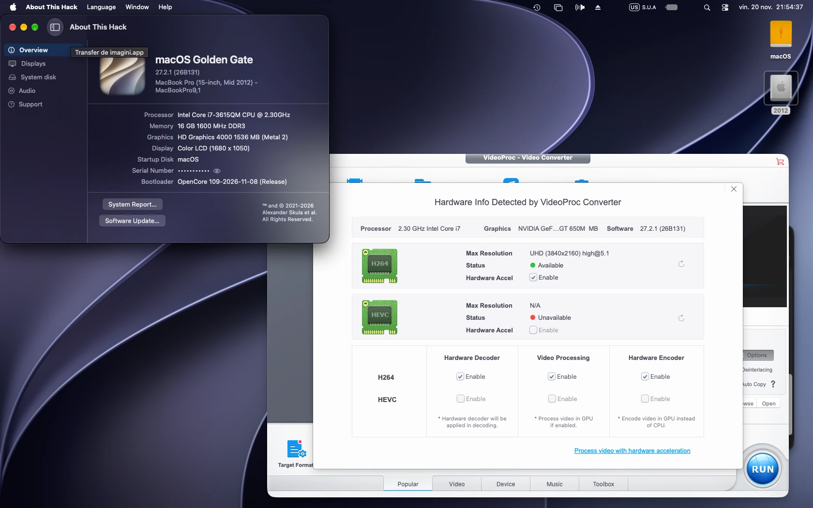
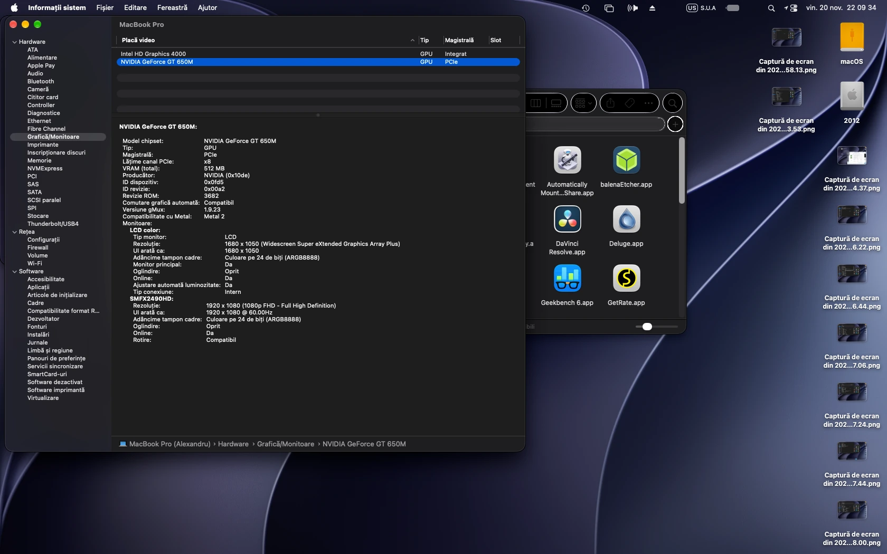

# GOLDEN GATE
### Bringing macOS 27 to the dual-GPU MacBook Pro 15″ (2012)

**An independent, hardware-tested adaptation of [lythka's HAO project](https://github.com/lythka/hao-patcher) for MacBookPro9,1.**

**ENGLISH** &nbsp; | &nbsp; [**ROMÂNĂ — COMPLETE EDITION**](README.ro.md)

**[The vision](#the-vision) · [Hardware in action](#hardware-in-action) · [Development](#the-development-story) · [Technical foundation](#engineering-foundation) · [Open challenges](#what-remains-open) · [Gallery](#visual-gallery)**

> [!IMPORTANT]
> **A working desktop, not yet a finished distribution.** On **19 November 2026**, Golden Gate 27.2.1 (26B131) reached Setup Assistant, account creation and the desktop on a real **15-inch Mid 2012 MacBook Pro**, booting from an external USB SSD. Restart and sign-in were subsequently confirmed. On **20 November**, a second image received focused repairs verified on the laptop. **Stage 1 is complete; the project remains experimental.**

<!-- GOLDEN-GATE-C-20261123-START -->
## Stage C — Toolchain, MacPorts and desktop compatibility (23–25 November 2026)

> **New milestone on the real 2012 MacBookPro9,1:** Apple CLT **27.2 / Clang 21** now compiles and runs **native x86_64 C, C++, LTO and make** programs through HAO. **Direct Clang builds for ARM64 and Universal 2 also PASS.** Xcode **27.2 (27B52)** has produced **5 successful x86_64 projects** and **10/10 ARM64/Universal 2 builds** (C, C++17, Objective-C, Swift, AppKit), with Universal 2 architectures verified in Mach-O and with `lipo`.

  

| Stage C result | Confirmed state |
|:--|:--|
| **Native Intel CLT** | C, C++, `-flto`, `make` and Python 3.14.10 x86_64 **PASS** |
| **Clang cross-architectures** | **ARM64-direct PASS** · **Universal2-direct PASS** |
| **Xcode compilation** | **5 Intel projects + 10/10 ARM64/Universal 2**, using `xcodebuild` and a native Intel Swift Build 6.4.2 service |
| **MacPorts 2.12.7** | We enabled source builds with our adapted Apple toolchain. **15/15 selected BASIC ports installed and active; 173 active ports overall (including supporting packages/dependencies) in the 24 November registry inventory.** Installation status is verified from the supplied report; per-port source-build origin and runtime testing are not. |
| **HAO / APFS integration** | Corrected compressed hardlink handling; **84 System + 3 Data CFG** components installed; new CLT snapshot boot confirmed |
| **Weather (25 Nov)** | **Opens reliably on the latest C snapshot, without spontaneous termination**; animated backgrounds, forecasts, main weather map and tested detail panels work. **The small map preview on the overview remains unfinished.** | Operator screenshot and latest physical observation; not full graphics-map certification |
| **Menu-bar battery and sound** | Correct icon orientation confirmed after reboot (battery terminal right; speaker sound waves right). | Does not establish battery level/charging accuracy or repair other missing icons |

**[25 November Weather / menu-bar milestone](golden-gate/build-c/WEATHER-MENUBAR-20261125.md)** · **[Română](golden-gate/build-c/WEATHER-MENUBAR-20261125.ro.md)**

**Read the full evidence, source patch and temporal sequence:** [**Build C technical index (EN)**](golden-gate/build-c/README.md) · [Română](golden-gate/build-c/README.ro.md) · [Chronological record](golden-gate/build-c/CHRONOLOGY.md) · [Clang evidence](golden-gate/build-c/TOOLCHAIN-EVIDENCE.md) · [Xcode 15-project matrix](golden-gate/build-c/XCODE.md) · [MacPorts live ledger](golden-gate/build-c/MACPORTS.md).

*The A/B photographs and descriptions below remain Stage 1 historical results from 20 November. Xcode CLI builds are verified; interactive IDE build, native Apple Silicon execution, full MacPorts inventory and a portable installer remain outside this milestone.*
<!-- GOLDEN-GATE-C-20261123-END -->

<!-- MBP91-PHOTO-SECTION-START -->
## Photographs — Golden Gate on the actual MacBookPro9,1

Real screenshots from **20 November 2026**, taken on the 15-inch MacBookPro9,1—not from the upstream MacBookPro9,2.

<table>
<tr>
<td width="50%" align="center" valign="top"> <strong>Golden Gate 27.2.1: a real, running desktop</strong> macOS 27.2.1 (26B131) · MacBookPro9,1</td>
<td width="50%" align="center" valign="top"> <strong>GT 650M: both screens on NVIDIA</strong> Internal 1680×1050 + external 1920×1080 display</td>
</tr>
</table>

**[View all 10 hardware screenshots →](golden-gate/GALLERY.md)** (Intel, NVIDIA, GMUX, Wi-Fi, Bluetooth, Ethernet, Thunderbolt 2, audio, storage and camera).

<!-- MBP91-PHOTO-SECTION-END -->

## The vision

**What if the breakthrough that brought macOS Golden Gate to the 13-inch 2012 MacBook Pro could be extended to its more complex 15-inch sibling?**

[lythka](https://github.com/lythka), the original creator of **HAO**, had shown that a MacBookPro9,2 could run Golden Gate by combining an Intel platform foundation with an ARM-to-x86 execution runtime. The 15-inch **MacBookPro9,1** shares the Intel Ivy Bridge generation and HD Graphics 4000—but adds an **NVIDIA GeForce GT 650M** and Apple's **GMUX**, the physical graphics multiplexer.

This is not a model-name substitution. It requires a compatible Intel kernel environment, boot and driver infrastructure, an ARM application translation layer, legacy graphics acceleration, and **real graphics switching between two GPUs**.

The project was initiated and directed by **[StefanAlMare](https://github.com/StefanAlMare)** to answer that technical question on real hardware. The goal is to **boot, configure and use Golden Gate on MacBookPro9,1**, document reproducible achievements, and investigate the remaining compatibility boundaries. The laptop's working Tahoe/OCLP installation has been retained independently.

## The test platform

| Component | Configuration |
|---|---|
| **Machine** | MacBook Pro 15-inch, Mid 2012 — MacBookPro9,1 |
| **CPU** | Intel Core i7-3615QM, Ivy Bridge |
| **Integrated graphics** | Intel HD Graphics 4000 |
| **Discrete graphics** | NVIDIA GeForce GT 650M, 512 MB |
| **Graphics multiplexer** | Apple GMUX |
| **Internal LCD** | 1680 × 1050 |
| **Operating system** | macOS Golden Gate 27.2.1, build **26B131** |
| **Intel donor** | macOS Tahoe 26.7.3, build **25G342** |
| **Boot and patching** | OpenCore, OpenCore Legacy Patcher, HAO |
| **Installation media** | External 256 GB USB SSD; original **80 GiB** APFS image |

## Hardware in action

**The achievement goes beyond a bootable image.** The laptop's primary hardware works, and the dual-GPU subsystem has shown meaningful switching behavior in real use.

| Area | Observed on MacBookPro9,1 |
|---|---|
| **Intel HD 4000 / internal display** | The built-in screen works at native resolution and is driven by **Intel** in the normal single-display configuration. |
| **NVIDIA GT 650M** | Recognized and usable. An explicit **Metal clear-and-readback** test on GT 650M returned **16/16 correct pixels**. |
| **GMUX + external monitor** | **Both displays switch to NVIDIA** when an external monitor is attached through the working direct video connection. |
| **GMUX after disconnect** | When that external monitor is removed through the working direct connection, the **internal screen returns to Intel HD 4000**. |
| **Application-driven GPU switching** | Opening **Photos** can put the internal screen on **NVIDIA without an external monitor**. |
| **External display** | Video through a direct mini DisplayPort–HDMI adapter works, including connection and reconnection. |
| **Thunderbolt hub** | HDMI video through the hub worked with the display connected at startup. **An earlier HDMI hot-unplug through the hub blacked out both displays**; that path remains unresolved. |
| **Connectivity** | **Wi-Fi, Bluetooth and Ethernet work.** The Wi-Fi and Bluetooth menu-bar **symbols are missing**, although the radios and clickable controls function. |
| **Input and illumination** | **Keyboard, mouse, trackpad, keyboard backlight, screen backlight, brightness keys and volume keys** work. |
| **USB and audio** | USB devices and sound operate in the tested configuration. |
| **Battery** | Battery data can be read and the Battery settings panel opens after repair; **the usage graphs are still incorrect**. |

### Dynamic graphics, not merely detected devices

The difference matters: **GMUX switching has been observed physically**. With the internal panel alone, Intel is used; attach an external monitor and NVIDIA drives both screens; remove that monitor and the internal display returns to Intel. **Photos can also trigger the NVIDIA path without an external monitor.**

This is stronger evidence than finding both GPUs in System Information. It is **not yet proof of every graphics workload or hot-plug condition**: the specific NVIDIA Metal test covers a 4 × 4 surface, some transparency artifacts remain, and HDMI unplugging through the Thunderbolt hub previously failed.

[**Hardware test evidence**](golden-gate/STAGE-1.md) · [**Engineering interpretation**](golden-gate/ENGINEERING.md)

## Desktop and applications

**Current Build C (25 November): Weather now launches without crashing and displays animated backgrounds, forecasts and the main weather map.** The smaller map preview on the overview is still incomplete. This supersedes the earlier A/B observation that Weather would not open; it is not a claim that every app or Weather feature is fully certified.

The usable desktop includes **Finder, Dock, window management, System Settings and Photos**, alongside the other apps tested. The second build also received verified, measurable fixes:

| Component | Engineering intervention | Measured or observed result |
|---|---|---|
| **Finder / IconServices** | Native Intel IconServices agent from Tahoe 25G422 | Four repeated icon requests went from **73 errors each to zero**; Finder responsive after restart |
| **Dock** | SkyLight bridge repair for mouse-button state | Magnification, icon labels and auto-reveal restored |
| **Window management** | SkyLight Option-key state bridge correction | Windows drag normally without unwanted tiling |
| **Battery preferences** | Foundation/Swift <code>DateComponents</code> compatibility repair | Battery pane no longer crashes on opening; period selectors work, **charts still incorrect** |

**Weather now runs on the latest C snapshot**; the overview's small map preview remains outstanding. The battery and speaker menu-bar icons also have the correct orientation after reboot. Some **Control Center** interactions still produce Swift crashes, and other desktop visual issues remain under investigation. [Detailed 25 November status](golden-gate/build-c/WEATHER-MENUBAR-20261125.md).

[**Image B repair ledger**](golden-gate/REGISTRU-TEHNIC-B.md)

## Engineering foundation

The image combines several independently identifiable layers:

| Layer | Why it is needed |
|---|---|
| **Golden Gate 26B131** | macOS 27 System and Data, Darwin 27, applications and frameworks |
| **Tahoe Intel donors** | x86_64 kernel extensions, boot/Recovery resources, DriverKit and selected native services |
| **HAO Runtime** | ARM-to-Intel execution, embedded launcher stubs and HaoExec |
| **OpenCore Legacy Patcher** | Intel Ivy Bridge, NVIDIA Kepler, legacy Metal and hardware compatibility |
| **OpenCore / GMUX profile** | MacBookPro9,1-specific EFI, kernel binding and dual-GPU configuration |
| **Verification** | SHA256 input checks, BootKC/SystemKC validation, <code>ocvalidate</code>, complete disk-image readback and actual hardware tests |

The local adaptation began from [HAO Patcher **6bd75aa**](https://github.com/lythka/hao-patcher/commit/6bd75aab112d1078acd8e75180eb510672461365) and [HAO Runtime **1547dcb**](https://github.com/lythka/hao-runtime/commit/1547dcb4e19a2ab0843086e3288223f998507a4c).

**Important technical boundary:** the locally produced bootstrap is not identical to the author's complete HAO compatibility payload; external interface units, thunk libraries and an optional async provider were not fully reproduced. That difference is documented, but is **not in itself a demonstrated explanation for any particular remaining UI failure**.

[**Read the engineering dossier**](golden-gate/ENGINEERING.md) · [**Inspect the original build records**](golden-gate/etape-a/INDEX.md)

## The development story

| Date | Milestone | Result |
|---|---|---|
| **17–18 Nov 2026** | **Hardware adaptation** | 9,1 target, Intel/NVIDIA/GMUX and OCLP configuration; OpenCore EFI validated |
| **17–18 Nov** | **Source and runtime work** | Golden Gate plus Tahoe donors, HAO build, 963 ARM-only program stubs, graphics assets and Intel kernel collections |
| **18 Nov** | **Image A** | 80 GiB APFS image built, written and fully read back from USB with matching SHA256; GPT/APFS expanded to the external SSD |
| **19 Nov** | **First desktop** | After investigating automount issues, Setup Assistant, account creation, desktop and login after restart succeeded |
| **19 Nov** | **GPU proof** | Internal panel identified on HD 4000; NVIDIA Metal 4 × 4 clear/readback passed **16/16 pixels** |
| **20 Nov** | **Image B / Stage 1 close** | Two Kepler ImageIO/CMPhoto overrides removed (**38 → 36** hardware operations); focused Finder, Dock, window and Battery fixes verified |

### The first obstacle: a stalled Setup Assistant

The first boots stopped near **60% progress**, while networking, keyboard events and disk activity continued. Logs identified pending operations involving **DiskImages, Disk Arbitration, FSKit and the temporary setup RAM disk**.

A sequence of tests changed automount behavior for the internal NTFS and exFAT partitions. With **both excluded from automount** by UUID-specific <code>ro,noauto</code> rules, Setup Assistant appeared and the Mac reached desktop.

This documents **a working configuration on one physical Mac**, not a universal diagnosis of macOS/FSKit; the stack traces did not conclusively identify the individual mount request.

### Two images, two distinct milestones

**Image A** achieved the initial boot, setup and desktop. **Image B** kept both Intel and NVIDIA drivers but removed two Kepler overrides of ImageIO and CMPhoto, changing the hardware recipe from **38 to 36 operations**. Additional repairs were then applied on B and evaluated separately.

[**Complete A/B history**](golden-gate/ISTORIC-A-B.md) · [**Build archive, steps 2–13**](golden-gate/etape-a/INDEX.md)

## What remains open

| Workstream | Current status |
|---|---|
| **Wi-Fi and Bluetooth menu-bar icons** | **Missing/invisible**, despite functioning radios and clickable controls |
| **NTFS and exFAT** | **Neither filesystem has been successfully mounted** in the documented Golden Gate setup |
| **Battery usage graphs** | Battery panel crash **fixed**, but displayed history/usage **not yet correct** |
| **Weather mini-map preview** | **Weather itself now launches and operates** on Build C; the small map preview on the overview page is still incomplete |
| **Control Center / desktop polish** | Some Swift crashes, incomplete battery/menu icons and inconsistent active-app indicators |
| **Thunderbolt / monitor hot-unplug** | External HDMI via the hub worked at startup but unplugging it previously blanked both screens; direct adapter tests worked |
| **NVIDIA rendering** | Some remaining visual artifacts in transparencies and borders |
| **HAO compatibility** | Complete external ABI units/thunks/provider still to be compared with upstream reference |

These are **specific engineering tasks**, not reasons to overlook the already working hardware.

## Visual gallery

**Ten authentic screenshots from the MacBookPro9,1 are now published.** The curated collection presents the Golden Gate desktop, both GPUs, the internal/external display configuration, Wi-Fi, Bluetooth, Ethernet, Thunderbolt, audio, camera and storage. The first two highlights are displayed above; the full gallery offers individual full-size views and bilingual captions. Additional photographs of app-triggered switching and future repairs can be added as new tests are documented.

**[View all 10 verified hardware screenshots](golden-gate/GALLERY.md)**

The [original HAO gallery](docs/gallery.md) illustrates the **13-inch MacBookPro9,2** and is not photographic proof of this 15-inch adaptation.

## Project documentation

| Document | Contents |
|---|---|
| [Engineering dossier](golden-gate/ENGINEERING.md) | Platform, kernel/graphics layers, verified test scope and limitations |
| [Stage 1 hardware report](golden-gate/STAGE-1.md) | First boot, desktop, NVIDIA test and subsequent GPU observations |
| [A/B development history](golden-gate/ISTORIC-A-B.md) | Full technical chronology in Romanian |
| [Image B technical ledger](golden-gate/REGISTRU-TEHNIC-B.md) | Repairs, rollback experiments and hashes in Romanian |
| [Source archive](golden-gate/etape-a/INDEX.md) | Original construction steps and script provenance |
| [Volume test kit](golden-gate/kit-volume/README.md) | Volume inventory and automount test planning |
| [Gallery](golden-gate/GALLERY.md) | Ten authentic MacBookPro9,1 screenshots with English/Romanian captions |
| [Notices](NOTICE.md) | Licensing and upstream attribution |

## Next chapter

**Stage 1 closed on 20 November 2026.** Build C has now restored Weather's launch and major display features, plus battery/sound icon orientation. Next: complete Weather's small map preview, investigate the still-missing Wi-Fi/Bluetooth icons, NTFS/exFAT mounts, battery usage graphs and Control Center, then continue GMUX/Thunderbolt and HAO ABI validation.

## People and credits

**[lythka](https://github.com/lythka)** — original creator and principal author of **HAO**, including the Golden Gate-on-Intel foundation and MacBookPro9,2 demonstration.

**[StefanAlMare](https://github.com/StefanAlMare)** — initiation, technical direction and coordination of the **MacBookPro9,1 adaptation**, hands-on hardware tests and verification of results.

**Codex (OpenAI)** — implementation assistance for local integration, construction tools, debugging and technical repairs, evaluated on the real laptop.

**Dortania, Acidanthera and other upstream contributors** — essential OCLP, OpenCore and related technologies; see [NOTICE.md](NOTICE.md).

> **Independent research preview.** Not affiliated with or endorsed by Apple. No Apple IPSWs, installers or macOS images are redistributed here. Success on this one test computer does not establish support for every Intel Mac.

[**Complete Romanian edition**](README.ro.md) · [**Engineering dossier**](golden-gate/ENGINEERING.md) · [**Original HAO**](https://github.com/lythka/hao-patcher)

