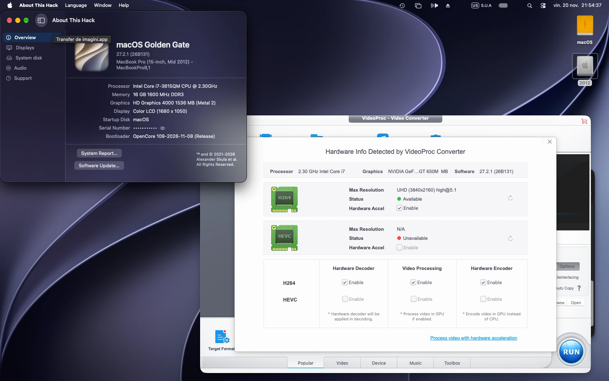
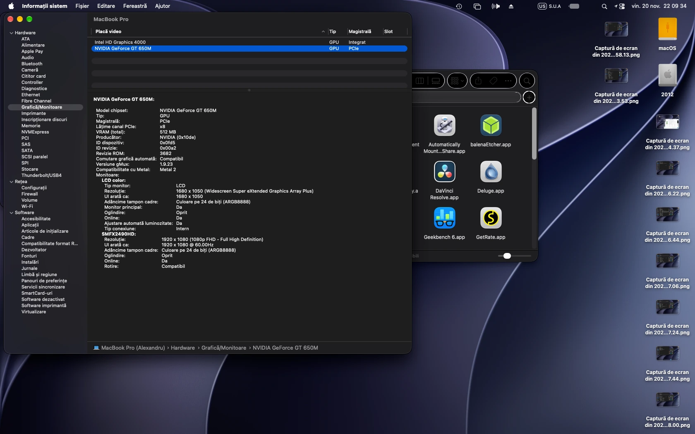

# GOLDEN GATE
### macOS 27 pe MacBook Pro 15″ din 2012, cu două plăci grafice

**O adaptare independentă pentru MacBookPro9,1, verificată pe hardware real, pornind de la [proiectul HAO al lui lythka](https://github.com/lythka/hao-patcher).**

[**ENGLISH**](README.md) &nbsp; | &nbsp; **ROMÂNĂ — VERSIUNE COMPLETĂ**

**[Ideea](#viziunea) · [Hardware](#hardware-în-funcțiune) · [Dezvoltarea](#parcursul-proiectului) · [Arhitectura](#baza-tehnică) · [Probleme](#ce-rămâne-de-rezolvat) · [Fotografii](#galeria-foto)**

> [!IMPORTANT]
> **Un desktop funcțional, dar nu încă o distribuție finalizată.** Pe **19 noiembrie 2026**, macOS Golden Gate 27.2.1 (26B131) a ajuns la Setup Assistant, configurarea contului și desktop pe un **MacBook Pro real de 15″, Mid 2012**, pornind de pe SSD USB extern. Autentificarea a reușit și după restart. Pe **20 noiembrie**, a doua imagine a primit reparații verificate pe laptop. **Etapa 1 este încheiată; proiectul rămâne experimental.**

<!-- MBP91-PHOTO-SECTION-START -->
## Fotografii — Golden Gate pe MacBookPro9,1 real

Capturi autentice din **20 noiembrie 2026**, de pe modelul de 15″ MacBookPro9,1, nu de pe MacBookPro9,2 al autorului.

<table>
<tr>
<td width="50%" align="center" valign="top"> <strong>Golden Gate 27.2.1: desktop funcțional</strong> macOS 27.2.1 (26B131) · MacBookPro9,1</td>
<td width="50%" align="center" valign="top"> <strong>GT 650M: ambele monitoare pe NVIDIA</strong> Ecran intern 1680×1050 + extern 1920×1080</td>
</tr>
</table>

**[Vezi toate cele 10 capturi hardware →](golden-gate/GALLERY.md)** (Intel, NVIDIA, GMUX, Wi-Fi, Bluetooth, Ethernet, Thunderbolt 2, audio, stocare și cameră).

<!-- MBP91-PHOTO-SECTION-END -->

## Viziunea

**Dacă autorul HAO a demonstrat că Golden Gate poate porni pe MacBook Pro-ul de 13″ din 2012, putem extinde soluția la versiunea de 15″, cu o arhitectură grafică mai complexă?**

[lythka](https://github.com/lythka), creatorul original **HAO**, demonstrase Golden Gate pe **MacBookPro9,2**, cu Ivy Bridge și Intel HD Graphics 4000. **MacBookPro9,1**, varianta de 15″, folosește aceeași generație Intel, dar are și **NVIDIA GeForce GT 650M**, plus **GMUX**, multiplexorul fizic de comutare grafică.

Așadar, nu este vorba doar despre schimbarea unui identificator. Era nevoie de un mediu kernel Intel compatibil, drivere vechi, execuția programelor ARM prin HAO și **comutarea reală între două procesoare grafice**.

Proiectul a fost inițiat și coordonat de **[StefanAlMare](https://github.com/StefanAlMare)** pentru a testa această posibilitate pe hardware real. Scopul este **pornirea și utilizarea Golden Gate pe MacBookPro9,1**, documentarea etapelor și investigarea limitelor rămase. Instalarea funcțională Tahoe/OCLP a fost păstrată separat, pentru comparație și recuperare.

## Configurația testată

| Componentă | Configurație |
|---|---|
| **Calculator** | MacBook Pro 15-inch, Mid 2012 — MacBookPro9,1 |
| **Procesor** | Intel Core i7-3615QM, Ivy Bridge |
| **Grafică integrată** | Intel HD Graphics 4000 |
| **Grafică dedicată** | NVIDIA GeForce GT 650M, 512 MB |
| **Multiplexor video** | Apple GMUX |
| **Display intern** | 1680 × 1050 |
| **macOS țintă** | Golden Gate 27.2.1, build **26B131** |
| **Donator Intel** | Tahoe 26.7.3, build **25G342** |
| **Boot și patching** | OpenCore, OpenCore Legacy Patcher, HAO |
| **Suport de test** | SSD USB extern de 256 GB; imagine APFS inițială de **80 GiB** |

## Hardware în funcțiune

**Nu ne-am oprit la o imagine bootabilă.** Hardware-ul principal funcționează, iar sistemul cu două plăci grafice a demonstrat comutare reală în utilizare.

| Domeniu | Ce am observat pe MacBookPro9,1 |
|---|---|
| **Intel HD 4000 / ecran intern** | Ecranul intern funcționează la rezoluția nativă și este controlat de **Intel** în configurația obișnuită, fără monitor extern. |
| **NVIDIA GT 650M** | Recunoscută și utilizabilă. Un test Metal explicit de umplere și recitire a returnat corect **16/16 pixeli** pe GT 650M. |
| **GMUX + monitor extern** | La conectarea monitorului extern prin conexiunea video directă funcțională, **ambele ecrane sunt controlate de NVIDIA**. |
| **GMUX după deconectare** | După scoaterea monitorului prin conexiunea directă funcțională, **ecranul intern revine la Intel HD 4000**. |
| **Comutare la cererea aplicației** | Lansarea **Photos / Poze** poate activa **NVIDIA pe ecranul intern și fără monitor extern**. |
| **Monitor extern** | Funcționează prin adaptor direct mini DisplayPort–HDMI, inclusiv după reconectare. |
| **Hub Thunderbolt** | Monitorul HDMI conectat prin hub a afișat imagine dacă era prezent de la pornire. **La o deconectare anterioară prin hub, ambele ecrane au rămas negre**; acest scenariu este încă deschis. |
| **Conectivitate** | **Wi-Fi, Bluetooth și Ethernet funcționează.** Lipsesc **simbolurile Wi-Fi și Bluetooth din bara de meniu**, dar conexiunile și comenzile accesibile prin clic funcționează. |
| **Dispozitive și iluminare** | **Tastatură, mouse, trackpad, iluminare tastatură și ecran, taste de luminozitate și de volum** funcționale. |
| **USB și audio** | Porturile și dispozitivele USB, precum și sunetul, funcționează în configurația probată. |
| **Baterie** | Sistemul citește informațiile bateriei, iar panoul Baterie se deschide după corecție; **graficele de utilizare încă nu sunt corecte**. |

### GMUX face efectiv comutarea

Cele două GPU nu apar doar într-o listă de dispozitive. **Comutarea a fost observată direct:** Intel controlează ecranul intern în utilizare obișnuită; cu un monitor extern, **NVIDIA controlează ambele ecrane**; după deconectarea directă, ecranul intern revine la Intel. **Photos poate solicita NVIDIA chiar fără monitor extern.**

Această funcționare este un rezultat important față de demonstrația originală pe MacBookPro9,2, modelul de 13″ cu un singur GPU. Totuși, testul Metal cu 16 pixeli **nu verifică toate shaderele**, unele transparențe NVIDIA prezintă artefacte, iar **deconectarea HDMI din hubul Thunderbolt a produs anterior pierderea imaginii**.

[**Probe hardware și NVIDIA**](golden-gate/STADIUL-1.md) · [**Interpretarea tehnică**](golden-gate/ENGINEERING.md)

## Desktop și aplicații

**Toate aplicațiile Apple încercate în ultimele teste practice au pornit, cu excepția Weather / Vreme.** Aceasta este observația utilizatorului, **nu o certificare a fiecărei funcții din fiecare aplicație**.

Desktopul utilizabil include **Finder, Dock, gestionarea ferestrelor, Configurări sistem și Photos**, alături de celelalte aplicații încercate. Imaginea B a primit și reparații confirmate:

| Componentă | Intervenție | Rezultat pe MacBookPro9,1 |
|---|---|---|
| **Finder / IconServices** | Agent Intel nativ din Tahoe 25G422 | Patru cereri de pictograme au trecut de la **73 de erori fiecare la zero**; Finder receptiv după restart |
| **Dock** | Corecție SkyLight pentru starea butonului mouse-ului | Mărirea pictogramelor, etichetele și reapariția automată funcționează |
| **Tragerea ferestrelor** | Corecție SkyLight pentru starea tastei Opțiune | Ferestrele se deplasează normal, fără mozaicare necerută |
| **Configurări → Baterie** | Corecție de compatibilitate Foundation/Swift pentru <code>DateComponents</code> | Panoul nu mai cade la deschidere și selecția perioadelor funcționează; **graficele rămân incorecte** |

**Weather** este aplicația care încă nu se deschide. Unele interacțiuni din **Centrul de control** pot produce în continuare erori Swift, deși desktopul și majoritatea aplicațiilor pornesc.

[**Registrul reparațiilor imaginii B**](golden-gate/REGISTRU-TEHNIC-B.md)

## Baza tehnică

Am combinat mai multe straturi de compatibilitate:

| Strat | De ce este necesar |
|---|---|
| **Golden Gate 26B131** | System și Data macOS 27, Darwin 27, aplicațiile și frameworkurile |
| **Donori Intel Tahoe** | Extensii kernel x86_64, resurse Boot/Recovery, DriverKit și servicii native selectate |
| **HAO Runtime** | Execuție ARM pe Intel, stubs și HaoExec |
| **OpenCore Legacy Patcher** | Intel Ivy Bridge, NVIDIA Kepler, Metal și compatibilitate cu hardware vechi |
| **OpenCore / profil GMUX** | EFI specific 9,1, legăturile kernel și configurația dual-GPU |
| **Validare** | SHA256, verificări BootKC/SystemKC, <code>ocvalidate</code>, recitirea integrală a imaginii și probe fizice |

Adaptarea locală a pornit de la [HAO Patcher **6bd75aa**](https://github.com/lythka/hao-patcher/commit/6bd75aab112d1078acd8e75180eb510672461365) și [HAO Runtime **1547dcb**](https://github.com/lythka/hao-runtime/commit/1547dcb4e19a2ab0843086e3288223f998507a4c).

**Limită tehnică:** bootstrap-ul HAO construit local nu este identic cu pachetul complet al autorului: unele interface units, biblioteci thunk externe și providerul async opțional nu au fost reproduse. Această diferență este documentată, dar **nu demonstrează singură cauza unei anumite probleme grafice sau de interfață**.

[**Dosarul de inginerie**](golden-gate/ENGINEERING.md) · [**Arhiva etapelor de construire**](golden-gate/etape-a/INDEX.md)

## Parcursul proiectului

| Data | Etapa | Rezultat |
|---|---|---|
| **17–18 nov. 2026** | **Adaptarea hardware** | Profil 9,1, selecții Intel/NVIDIA/GMUX și OCLP; EFI OpenCore validat |
| **17–18 nov.** | **Pregătirea surselor** | Golden Gate și donori Tahoe, runtime HAO, 963 stubs pentru executabile ARM-only, componente Metal și colecții kernel |
| **18 nov.** | **Imaginea A** | Imagine APFS de 80 GiB, scrisă și recitită integral pe USB cu SHA256 identic; GPT/APFS extinse |
| **19 nov.** | **Primul desktop** | După investigarea automontării, Setup Assistant, configurarea contului, desktopul și autentificarea după repornire au funcționat |
| **19 nov.** | **Proba GPU** | Ecran intern pe HD 4000; test NVIDIA Metal 4 × 4 cu **16/16 pixeli** corecți |
| **20 nov.** | **Imaginea B / închiderea etapei 1** | Eliminarea a două suprascrieri Kepler ImageIO/CMPhoto (**38 → 36** operații); reparații Finder, Dock, ferestre și Baterie confirmate |

### De la bara blocată la configurarea inițială

Primele porniri se opreau la circa **60% din bara Apple**, deși funcționau procesarea tastaturii, traficul de rețea și discul. Jurnalele arătau așteptări asociate cu **DiskImages, Disk Arbitration, FSKit și discul RAM de configurare**.

O serie de probe a izolat comportamentul automontării volumelor NTFS și exFAT. Când **ambele volume interne au fost excluse de la automontare**, prin reguli <code>ro,noauto</code> distincte pentru UUID, configurarea s-a deschis și MacBook-ul a ajuns la desktop.

Aceasta este **o intervenție demonstrată pe calculatorul respectiv**, nu un remediu universal pentru FSKit. Capturile nu au identificat definitiv volumul cererii de montare.

### Imaginea A și imaginea B

**A** a demonstrat prima pornire USB și primul desktop. **B** a păstrat Intel și NVIDIA, dar a eliminat două suprascrieri Kepler ImageIO/CMPhoto, reducând profilul de la **38 la 36 de operații**. Ulterior, pe B au fost aplicate și verificate reparațiile de interfață.

[**Istoricul complet A/B**](golden-gate/ISTORIC-A-B.md) · [**Etapele 2–13**](golden-gate/etape-a/INDEX.md)

## Ce rămâne de rezolvat

| Problemă | Stadiu |
|---|---|
| **Pictogramele Wi-Fi și Bluetooth** | **Nu sunt vizibile în bara de meniu**, deși dispozitivele și zonele de control funcționează |
| **NTFS și exFAT** | **Volumele nu au putut fi montate cu succes** în configurația Golden Gate documentată |
| **Graficele bateriei** | Eroarea de deschidere a panoului este **rezolvată**, dar **graficele de consum și utilizare încă nu sunt corecte** |
| **Weather / Vreme** | **Nu se deschide** în imaginea documentată |
| **Control Center și interfață** | Unele căderi Swift, simboluri incomplete și indicatori de aplicații active inconsistenți |
| **Thunderbolt / video extern** | HDMI prin hub funcționează la pornire, dar o deconectare anterioară a lăsat ambele ecrane negre; conexiunea directă a funcționat |
| **Randarea NVIDIA** | Unele transparențe și contururi prezintă artefacte |
| **Compatibilitatea HAO** | Este necesară evaluarea diferențelor dintre bootstrap-ul local și pachetul ABI extern complet al autorului |

**Există deja hardware și aplicații funcționale; problemele rămase sunt sarcini tehnice delimitate.**

## Galeria foto

**Cele zece capturi autentice de pe MacBookPro9,1 sunt acum publicate.** Galeria documentează desktopul Golden Gate, cele două GPU, configurația cu monitor intern și extern, Wi-Fi, Bluetooth, Ethernet, Thunderbolt, audio, cameră și stocare. Cele două imagini principale sunt afișate mai sus, iar galeria completă permite deschiderea fiecărei capturi și include explicații în engleză și română. Vom putea adăuga fotografii suplimentare cu comutarea grafică la cererea aplicațiilor și reparațiile viitoare.

**[Vezi toate cele 10 capturi autentice](golden-gate/GALLERY.md)**

[Galeria originală HAO](docs/gallery.md) prezintă **MacBookPro9,2** și nu este folosită drept dovadă vizuală pentru 9,1.

## Harta documentației

| Document | Conținut |
|---|---|
| [Dosarul tehnic](golden-gate/ENGINEERING.md) | Platforma, componentele, probele și limitele |
| [Stadiul 1](golden-gate/STADIUL-1.md) | Prima pornire, desktop și NVIDIA Metal |
| [Istoric A/B](golden-gate/ISTORIC-A-B.md) | Cronologia completă a dezvoltării |
| [Registru tehnic B](golden-gate/REGISTRU-TEHNIC-B.md) | Reparații, teste retrase și hash-uri |
| [Etapele 2–13](golden-gate/etape-a/INDEX.md) | Scripturi istorice și surse de construire |
| [Kit pentru volume](golden-gate/kit-volume/Citeste.md) | Inventar și probe NTFS/exFAT |
| [Galeria foto](golden-gate/GALLERY.md) | Zece capturi autentice MacBookPro9,1, cu explicații bilingve |
| [Credite și licențe](NOTICE.md) | Atribuiri upstream |

## Ce urmează

**Etapa 1 s-a încheiat la 20 noiembrie 2026.** Urmează reparațiile pentru simbolurile Wi-Fi/Bluetooth, montarea NTFS/exFAT, graficele bateriei, Weather și Control Center, plus validarea suplimentară GMUX/Thunderbolt și a compatibilității ABI Hao.

## Autori și credite

**[lythka](https://github.com/lythka)** — creatorul și autorul principal al **HAO**, al bazei Golden Gate pe Intel și al demonstrației MacBookPro9,2.

**[StefanAlMare](https://github.com/StefanAlMare)** — inițiativa, coordonarea tehnică și adaptarea **MacBookPro9,1**, testele fizice și confirmarea rezultatelor.

**Codex (OpenAI)** — contribuție de implementare asistată la integrarea locală, instrumentele de construire, diagnostic și reparații, validate ulterior pe laptop.

**Dortania, Acidanthera și ceilalți contributori originali** — OpenCore Legacy Patcher, OpenCore și alte componente esențiale creditate în [NOTICE.md](NOTICE.md).

> **Proiect de cercetare independent și experimental.** Nu este afiliat Apple și nu redistribuie IPSW-uri, instalatoare sau imagini macOS. Reușita pe un singur MacBookPro9,1 nu garantează compatibilitatea altor modele Intel.

[**Read in English**](README.md) · [**Dosar tehnic**](golden-gate/ENGINEERING.md) · [**HAO original**](https://github.com/lythka/hao-patcher)

