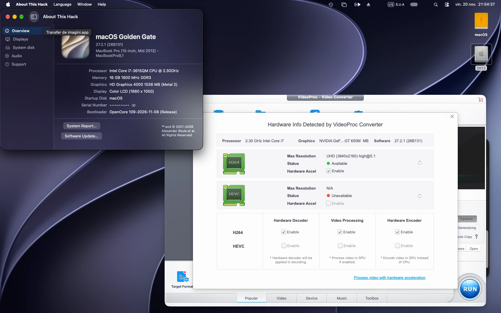
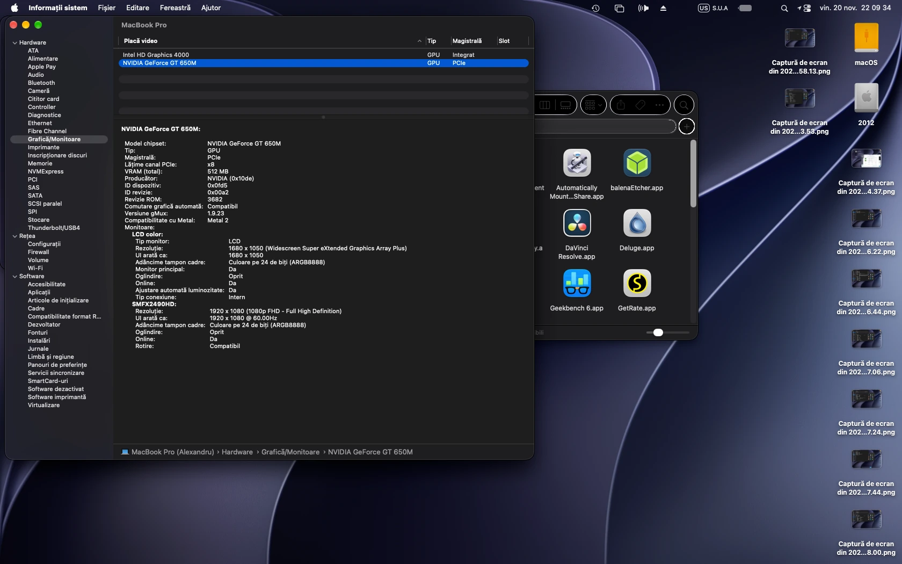
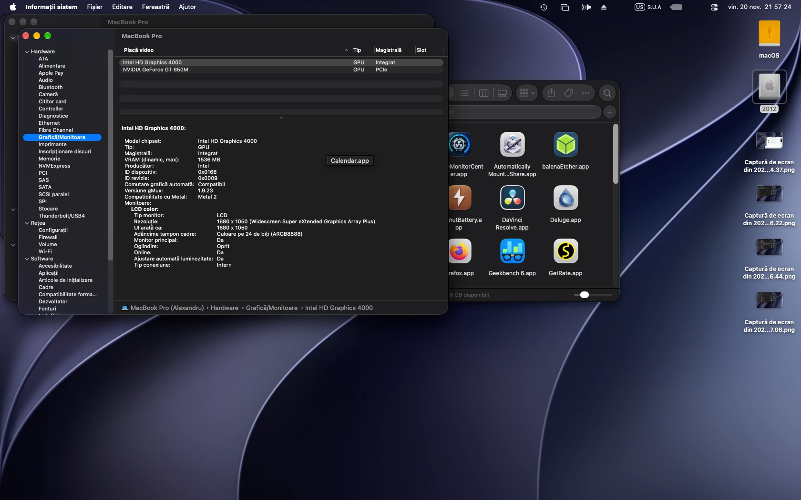
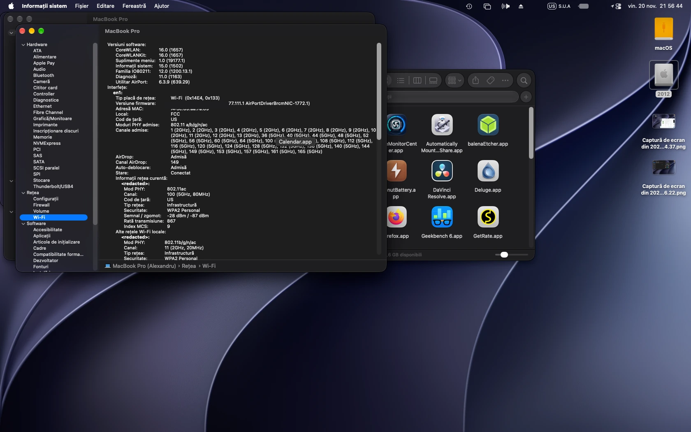
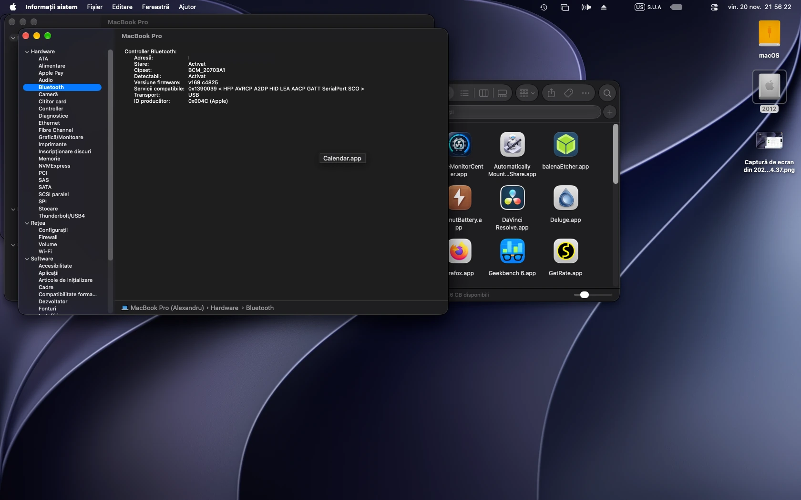
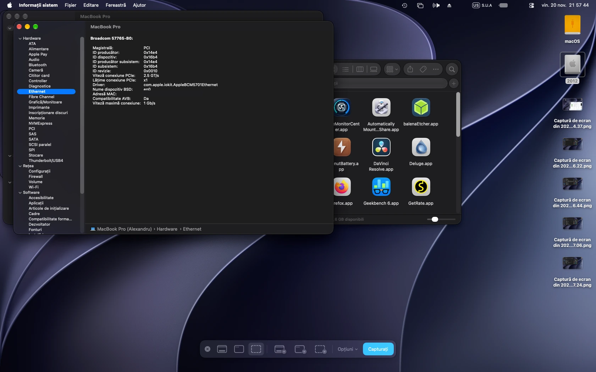
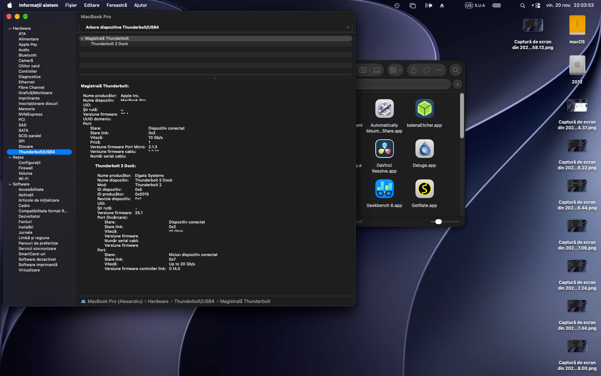
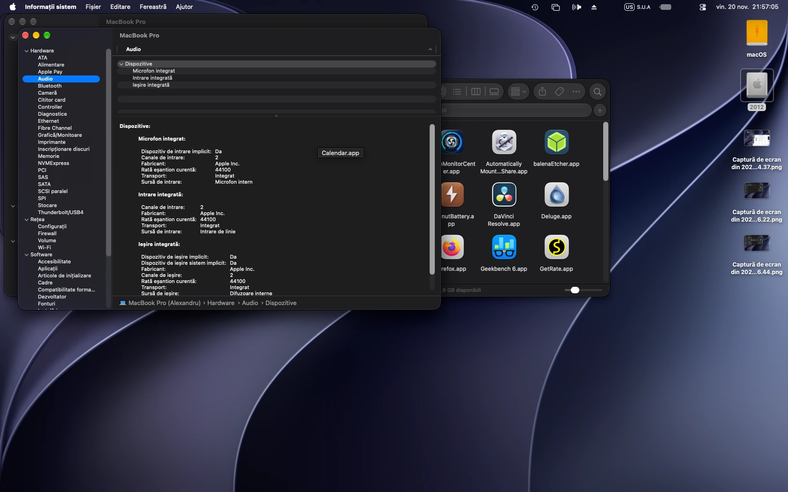
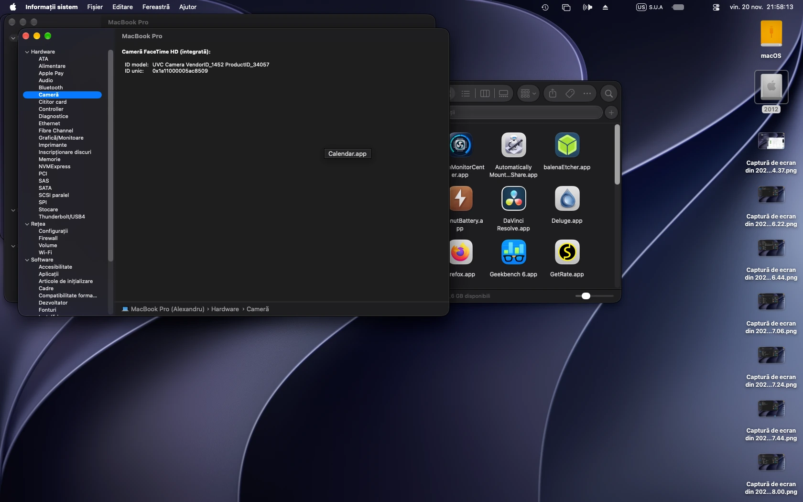
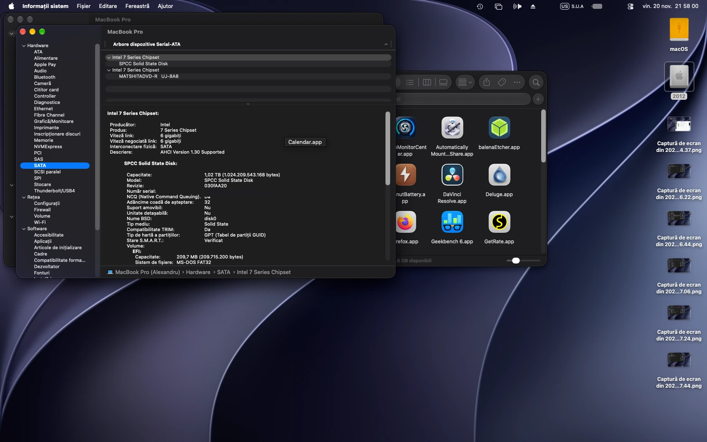

# Golden Gate 27.2.1 — MacBookPro9,1 / 15-inch Mid 2012

**[English project homepage](../README.md) · [Versiunea română](../README.ro.md) · [Engineering dossier](ENGINEERING.md)**

> **Authentic screenshots from the 15-inch MacBookPro9,1 tested by [StefanAlMare](https://github.com/StefanAlMare), captured on 20 November 2026.** These are not images from the original MacBookPro9,2 HAO project. Photos document device recognition and particular observations, not a blanket compatibility certification. Personal hardware addresses and serial identifiers have been obscured.

> **Română:** Capturi autentice din 20 noiembrie 2026, realizate pe MacBookPro9,1 de 15″, testat de StefanAlMare. Nu sunt fotografii de pe MacBookPro9,2 al autorului HAO. Unele dovezi indică detectarea dispozitivelor, nu funcționarea fiecărei caracteristici. Adresele hardware și numerele de serie private au fost mascate.

## 01 — Working desktop and the dual-GPU result

**Golden Gate 27.2.1 reaches the desktop, and NVIDIA drives the internal and external displays in the dual-screen configuration.**

<table>
<tr>
<td width="50%" valign="top" align="center">
  
  
<strong>Golden Gate 27.2.1 — live desktop</strong> <em>Desktop Golden Gate 27.2.1</em>

  
About This Hack identifies macOS 27.2.1 (26B131), the Mid 2012 15-inch model, Intel i7 and HD 4000. VideoProc reports H.264 acceleration available; HEVC unavailable. <em>About This Hack identifică 27.2.1 (26B131) și MacBook Pro 15″ din 2012. VideoProc raportează accelerare H.264 disponibilă, iar HEVC indisponibilă.</em>

</td>
<td width="50%" valign="top" align="center">
  
  
<strong>NVIDIA GT 650M — both screens</strong> <em>NVIDIA GT 650M — ambele ecrane</em>

  
System Information lists the internal 1680×1050 LCD and an external 1920×1080 monitor under NVIDIA GT 650M; both are online. <em>Informații sistem arată LCD-ul intern 1680×1050 și un monitor extern 1920×1080 sub NVIDIA GT 650M, ambele online.</em>

</td>
</tr>
</table>

## 02 — Intel graphics and wireless networking

**Intel HD 4000 on the internal panel; Broadcom Wi-Fi associated and active.**

<table>
<tr>
<td width="50%" valign="top" align="center">
  
  
<strong>Intel HD 4000 — internal LCD</strong> <em>Intel HD 4000 — LCD intern</em>

  
The internal 1680×1050 panel is detected under Intel HD 4000 with Metal 2 support and automatic graphics switching reported as compatible. <em>LCD-ul intern 1680×1050 este identificat pe Intel HD 4000, cu Metal 2 și compatibilitate cu comutarea automată.</em>

</td>
<td width="50%" valign="top" align="center">
  
  
<strong>Broadcom Wi-Fi — connected</strong> <em>Wi-Fi Broadcom — conectat</em>

  
System Information reports an active 802.11ac link, WPA2 security, associated access point and AirDrop capability. <em>Informații sistem confirmă conexiune 802.11ac activă, WPA2, punct de acces asociat și suport AirDrop.</em>

</td>
</tr>
</table>

## 03 — Bluetooth and wired Ethernet

**Controller and network-driver evidence from System Information.**

<table>
<tr>
<td width="50%" valign="top" align="center">
  
  
<strong>Bluetooth controller — active</strong> <em>Controller Bluetooth — activ</em>

  
The Bluetooth controller is active and recognized, with supported device-service profiles listed. <em>Controllerul Bluetooth este activ și recunoscut, cu profiluri de servicii enumerate.</em>

</td>
<td width="50%" valign="top" align="center">
  
  
<strong>Broadcom Gigabit Ethernet</strong> <em>Ethernet Gigabit Broadcom</em>

  
Broadcom 57765-B0 appears as en0 with AppleBCM5701Ethernet and maximum 1 Gb/s link capability. <em>Broadcom 57765-B0 este identificat ca en0, prin AppleBCM5701Ethernet, cu capacitate 1 Gb/s.</em>

</td>
</tr>
</table>

## 04 — Thunderbolt 2 and built-in audio

**The Thunderbolt 2 dock is enumerated, while HDMI hot-disconnection through this hub is still a known issue.**

<table>
<tr>
<td width="50%" valign="top" align="center">
  
  
<strong>Thunderbolt 2 dock recognized</strong> <em>Dock Thunderbolt 2 recunoscut</em>

  
An Elgato Thunderbolt 2 Dock is enumerated on the Thunderbolt bus with a 10 Gb/s active link. Display hot-unplug through the dock is not yet reliable. <em>Dockul Elgato Thunderbolt 2 apare în magistrală, cu legătură activă de 10 Gb/s. Deconectarea monitorului prin dock rămâne problematică.</em>

</td>
<td width="50%" valign="top" align="center">
  
  
<strong>Built-in audio devices</strong> <em>Dispozitive audio integrate</em>

  
System Information lists the integrated microphone, line input and built-in output. Audio function has also been reported working on the test Mac. <em>Sistemul identifică microfonul, intrarea de linie și ieșirea internă; funcționarea sunetului a fost confirmată și practic.</em>

</td>
</tr>
</table>

## 05 — Camera and storage

**Detected devices: built-in FaceTime camera, Intel SATA/AHCI controller and internal SSD.**

<table>
<tr>
<td width="50%" valign="top" align="center">
  
  
<strong>Built-in FaceTime HD camera detected</strong> <em>Camera FaceTime HD detectată</em>

  
The integrated FaceTime HD camera is enumerated. This screenshot demonstrates detection, not a captured video stream. <em>Camera FaceTime HD integrată este recunoscută; captura dovedește detectarea, nu testarea unui flux video.</em>

</td>
<td width="50%" valign="top" align="center">
  
  
<strong>Intel SATA controller and SSD</strong> <em>Controller SATA Intel și SSD</em>

  
Intel 7 Series SATA/AHCI and an internal SSD are recognized. Golden Gate itself was tested from a separate USB SSD. <em>Controllerul Intel 7 Series SATA/AHCI și SSD-ul intern sunt recunoscute. Golden Gate a fost testat de pe SSD USB separat.</em>

</td>
</tr>
</table>

## What the screenshots do — and do not — prove

- **Proven by an actual image:** Golden Gate desktop, OS build/model information, internal panel on Intel HD 4000, internal plus external monitor listed under NVIDIA, connected Wi-Fi, active Bluetooth and recognized hardware devices.
- **Proven by separate project tests:** NVIDIA Metal 4×4 clear/readback (**16/16 pixels**), GMUX transitions between Intel/NVIDIA observed by the operator, and working sound/input/USB.
- **Still open:** Wi-Fi and Bluetooth menu-bar icons, NTFS/exFAT mounting, battery usage charts, Weather, certain Control Center calls and HDMI hot-unplug through the Thunderbolt dock.
- **Important:** VideoProc's H.264 acceleration status is **the application's reported capability**; this screenshot is not a measured encoding benchmark. The camera screenshot only establishes detection.

**More information:** [First boot and GPU validation](STAGE-1.md) · [Complete A/B history (RO)](ISTORIC-A-B.md) · [Image B repair ledger (RO)](REGISTRU-TEHNIC-B.md).

**Credits:** Original HAO: [lythka](https://github.com/lythka). MacBookPro9,1 adaptation, hardware experiments and screenshots: [StefanAlMare](https://github.com/StefanAlMare). Implementation assistance: Codex (OpenAI).
